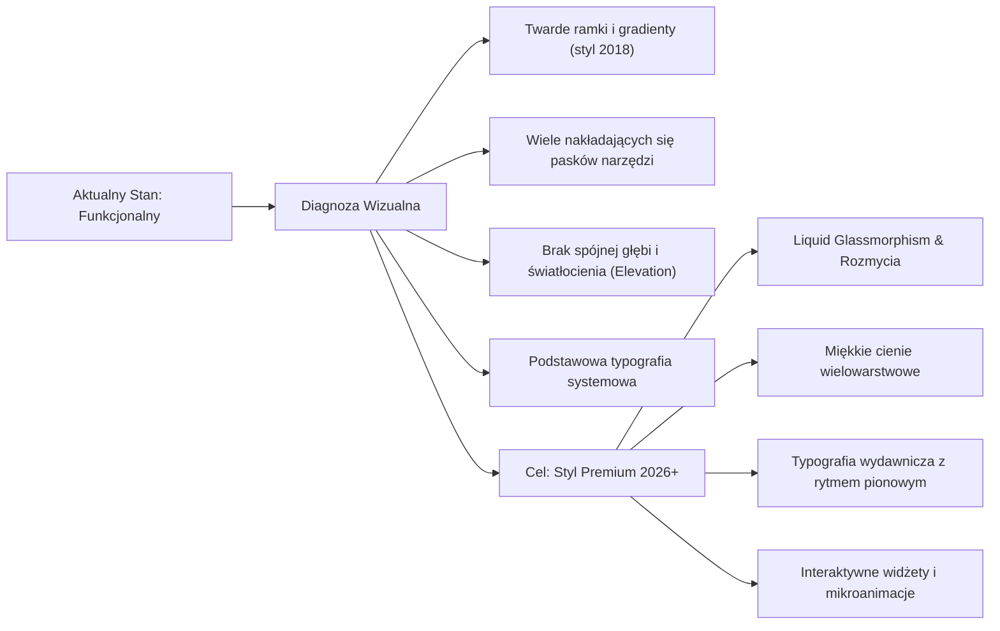
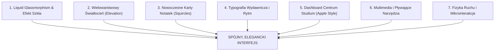
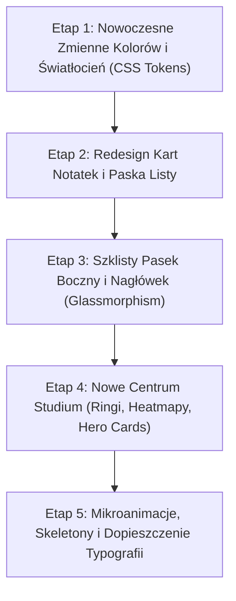

# Audyt Wizualny i Plan Podniesienia Grafiki na Wyższy Poziom — JW-Study 5.0

> [!NOTE]
> Niniejszy dokument stanowi kompleksowy audyt interfejsu użytkownika (UI) oraz doświadczenia wizualnego (UX) aplikacji **JW-Study 5.0**. Zawiera diagnozę obecnego stylu graficznego, analizę porównawczą ze standardami nowoczesnych aplikacji studyjnych (Apple Notes, Craft, Bear, Linear, Things 3) oraz gotową strategię wyniesienia grafiki na poziom klasy premium.

---

## 1. Diagnoza Stanu Obecnego (Gdzie jesteśmy?)

Aplikacja **JW-Study 5.0** przeszła ogromną ewolucję funkcjonalną: posiada rozbudowane bazy danych, czytnik pełnoekranowy, odtwarzacze multimediów, zaawansowane filtry, system etykiet, synchronizację oraz moduł Centrum Studium z celami i planami czytania.

Jednak od strony wizualnej aplikacja niesie ze sobą **nawarstwiony styl z wcześniejszych wersji**:



### Główne mankamenty obecnej grafiki:

1. **Płaskie lub twarde gradienty w nagłówku i kartach:**
   Górny pasek nagłówka (`header`) ma ciemnozielony gradient z mocnym cieniem z 2018 roku, podczas gdy karty notatek i paski narzędzi posiadają proste obramowania `1px solid rgba(0,0,0,0.08)`. Sprawia to wrażenie aplikacji użytkowej, a nie luksusowego narzędzia do osobistego studium.
2. **Niejednolita głębia (brak zdefiniowanego systemu poziomów - Elevation System):**
   Elementy unoszące się (modale, menu podręczne, dropdowny, karty na tablicy) mają różne promienie zaokrągleń (od `8px` przez `10px`, `14px` do `20px`) i przypadkowe cienie. Brakuje trójwymiarowej hierarchii (warstwa 0 = tło, warstwa 1 = kolumny, warstwa 2 = karty, warstwa 3 = paski pływające, warstwa 4 = okna modalne).
3. **Gęstość i natłok kontrolek nad listą notatek:**
   Pasek filtrów, widoków, wyszukiwarki i sortowania zajmuje dużo przestrzeni pionowej, co na iPadzie i telefonie odwraca uwagę od samej treści studium.
4. **Karty notatek na liście i tablicy:**
   Obecnie karty notatek to białe prostokąty z dużą liczbą małych przycisków ikonowych (`btnrow`). Brakuje nowoczesnego akcentu typograficznego, miękkiego tła, subtelnych plakietek metadanych i dopracowanego układu ze zdjęciem.
5. **Centrum Studium:**
   Układ 4 kart (Hero Grid) i wykresy kołowe są bardzo funkcjonalne, ale mogą wyglądać jak z nowoczesnego systemu Apple Health / Fitness — ze świecącymi ringami SVG, wykresami słupkowymi z gradientem i szklanymi kartami.

---

## 2. Filary Transformacji Graficznej (Jak wejść na poziom mistrzowski?)

Aby wynieść grafikę JW-Study na najwyższy poziom rynkowy, wdrażamy **7 filarów nowoczesnego designu**:



---

### Filar 1: Nowoczesne Szkło (Liquid Glassmorphism & Frosted Panes)

Zamiast jednolitego białego lub szarego tła, stosujemy efekt mrożonego szkła znany z systemów macOS Sonoma / iOS 18:

```css
/* Nowoczesna klasa szklanej powierzchni */
.glass-surface {
  background: rgba(255, 255, 255, 0.72);
  backdrop-filter: blur(20px) saturate(190%);
  -webkit-backdrop-filter: blur(20px) saturate(190%);
  border: 1px solid rgba(255, 255, 255, 0.4);
  box-shadow: 
    0 0 0 1px rgba(0, 0, 0, 0.03) inset,
    0 8px 32px -4px rgba(0, 0, 0, 0.06);
}

/* W trybie ciemnym */
html[data-theme="dark"] .glass-surface {
  background: rgba(21, 29, 40, 0.75);
  backdrop-filter: blur(24px) saturate(180%);
  -webkit-backdrop-filter: blur(24px) saturate(180%);
  border: 1px solid rgba(255, 255, 255, 0.08);
  box-shadow: 
    0 0 0 1px rgba(255, 255, 255, 0.05) inset,
    0 12px 36px -6px rgba(0, 0, 0, 0.45);
}
```

* **Zastosowanie:** Pasek boczny (Sidebar), nagłówek, pływające menu akcji, pasek odtwarzacza audio i dolny pasek podsumowania.

---

### Filar 2: System Światłocienia i Głębokości (Layered Elevation)

Wprowadzamy precyzyjną hierarchię 4 poziomów z miękkimi, wielostopniowymi cieniami:

| Poziom | Zastosowanie | Cień i wykończenie |
| :--- | :--- | :--- |
| **L0 (Canvas)** | Główne tło aplikacji | Naturalna, głęboka satynowa szarość `#f6f8fa` (jasny) lub `#0b0f14` (ciemny) z delikatnym radialnym akcentem barwnym. |
| **L1 (Panels)** | Kolumny: Biblia, Etykiety, Publikacje | `border-radius: 18px`, obramowanie wewnętrzne `1px solid rgba(0,0,0,0.05)`, płaskie tło z delikatnym cieniem bocznym. |
| **L2 (Cards)** | Karty notatek, kafelki zadań w Centrum | Miękki podwójny cień: ambient + directional: `0 2px 4px rgba(0,0,0,.02), 0 10px 24px -4px rgba(0,0,0,.06)`. |
| **L3 (Floating)** | Pasek edytora, odtwarzacz audio, wyszukiwarka | Pływające zaokrąglenie pigułkowe (`border-radius: 999px` lub `16px`), `box-shadow: 0 14px 40px -8px rgba(0,0,0,.14)`. |
| **L4 (Modals)** | Czytnik `#modalFs`, edycja notatki, cele | Głębokie zaciemnienie tła z rozmyciem `backdrop-filter: blur(8px)`, obramowanie z poświatą. |

---

### Filar 3: Redesign Kart Notatek (Karty klasy Craft / Apple Notes)

Obecne karty notatek mają zbyt dużo surowych krawędzi i nagromadzonych ikon. Nowy projekt wprowadza:

1. **Płynne krzywizny (Superellipse / Squircle):** Zaokrąglenie `16px`–`18px`.
2. **Akcent krawędziowy lub subtelna poświata:**
   Zamiast jaskrawego tła, karta z etykietą lub projektem otrzymuje elegancki, pionowy gradientowy akcent na lewej krawędzi lub delikatne zabarwienie nagłówka.
3. **Typografia tytułu z dynamicznym kontrastem:**
   Tytuł notatki o grubości `font-weight: 700`, z subtelnym trackingiem `-0.02em` i automatycznym podziałem wierszy.
4. **Interaktywny miniaturowy podgląd mediów:**
   Jeśli notatka zawiera zdjęcie lub nagranie audio, media prezentowane są w zaokrąglonym kadrze z proporcjami 16:9 lub eleganckiej pigułce z ikoną fali dźwiękowej.
5. **Dyskretne menu kontekstowe:**
   Zamiast rzędu 6 przycisków zawsze widocznych na karcie, przyciski pojawiają się płynnie po najechaniu myszą lub w formie nowoczesnego przycisku `···` z bogatym menu dotykowym.

---

### Filar 4: Typografia Wydawnicza (Editorial Typography)

Czytanie i studiowanie publikacji oraz Pisma Świętego wymaga najwyższej troski o wzrok:

1. **Fonty o proporcjach wydawniczych:**
   - Wykorzystanie optymalnego zestawu krojów:
     - Inter / San Francisco dla interfejsu i etykiet.
     - New York / Charter / Georgia / Merriweather dla czytnika w trybie książkowym.
2. **Skalowanie modułowe (Modular Typography Scale):**
   - H1: `26px` / `line-height: 1.25` / `letter-spacing: -0.03em`
   - H2: `20px` / `line-height: 1.3` / `letter-spacing: -0.02em`
   - Treść notatki: `15.5px` – `16.5px` / `line-height: 1.62` (złota proporcja czytelności)
   - Metadane i etykiety: `12px` / `font-weight: 600` / `letter-spacing: 0.02em`
3. **Cytaty wersetów (Callouty biblijne):**
   - Specjalne bloki wersetów z delikatnym tłem w kolorze kości słoniowej/szałwii, lewym paskiem ze złotawą poświatą i czytelnym odsyłaczem z ikoną Pisma Świętego.

---

### Filar 5: Centrum Studium 2.0 (Duchowy Dashboard Premium)

Centrum Studium może stać się wizytówką graficzną całej aplikacji:

1. **Świecące pierścienie postępu (Neon SVG Activity Rings):**
   Zamiast płaskiego paska postępu, czytanie roczne Biblii i realizacja celów prezentowane w postaci okręgów w stylu Apple Fitness (z miękkim gradientem i zaokrąglonymi końcami).
2. **Kalendarz nawyków (Habit Heatmap):**
   Siatka kwadratów oznaczających codzienne studium z łagodnymi odcieniami szmaragdowej zieleni (`#10b981`).
3. **Karty etapów życia Jezusa:**
   Eleganckie kafelki z dynamicznymi etykietami ewangelistów (Mateusz, Marek, Łukasz, Jan w dedykowanych pastelowych odcieniach).

---

### Filar 6: Multimedialny Odtwarzacz & Pływające Narzędzia

Odtwarzacz audio i wideo połączony z notatkami:

1. **Waveform (Animowana wizualizacja fali audio):**
   Pasek postępu audio z dynamicznymi słupkami fali dźwiękowej zamiast prostego suwaka `input[type="range"]`.
2. **Pływająca pigułka kontrolna (Dynamic Island Style):**
   Gdy użytkownik przewija notatkę w dół, miniaturowy odtwarzacz zwija się do dyskretnej szklanej pigułki przy dolnej lub górnej krawędzi, nie zasłaniając tekstu.
3. **Formatowanie Slash Menu (`/`):**
   Nowoczesne, pływające menu w stylu Notion / Craft z płynną animacją pojawiania się, ikonami kategorii i podświetleniem opcji.

---

### Filar 7: Fizyka Ruchu i Mikrointerakcje (Spring Physics & Haptic Cues)

Statyczny interfejs wydaje się ciężki; animowany ze sprzężeniem sprężystym daje uczucie lekkości:

1. **Krzywe ruchu Apple Spring:**
   ```css
   /* Płynne otwieranie okien i kart */
   transition: transform 0.28s cubic-bezier(0.16, 1, 0.3, 1), 
               opacity 0.22s ease, 
               box-shadow 0.28s ease;
   ```
2. **Skeleton Loaders (Szkielety ładowania):**
   Zamiast napisu „Wczytywanie notatek...”, karty notatek podczas startu pokazują pulsujące szare szkielety z efektem fali świetlnej (`shimmer`), co sprawia, że aplikacja wydaje się ładować natychmiastowo.
3. **Płynne przełączanie widoków (Lista ↔ Tablica):**
   Karty nie przeskakują skokowo, lecz płynnie animują swoje położenie (`layout animation`).

---

## 3. Plan Wdrożenia (Krok po Kroku)

Wdrożenie ulepszeń graficznych można przeprowadzić modułowo, bez naruszania istniejącej bazy danych i logiki:



### Podsumowanie etapów:

1. **Etap 1: Fundament wizualny (Design Tokens)**
   Ujednolicenie zmiennych CSS dla 4 motywów (Dzień, Noc, OLED, Sepia), wprowadzenie zmiennych wielowarstwowych cieni (`--elevation-1` do `--elevation-4`) oraz promieni squircles (`--radius-card: 16px`).
2. **Etap 2: Nowe karty notatek**
   Uproszczenie wyglądu kart, lepsze kadrowanie zdjęć, szlachetne badge wersetów i publikacji, ukrycie nadmiaru przycisków w menu `···`.
3. **Etap 3: Nowoczesny nagłówek i pasek boczny**
   Przekształcenie nagłówka w lżejszą, szklaną formę, redukcja wysokości, integracja wyszukiwarki z delikatną poświatą przy focusie.
4. **Etap 4: Dashboard Centrum Studium**
   Wdrożenie ringów aktywności SVG, odświeżenie widżetu stopera i kart projektów.
5. **Etap 5: Płynność i mikrointerakcje**
   Dodanie animacji sprężystych, skeleton loaderów przy starcie i dopracowanie typografii czytnika.

---

> [!TIP]
> Każdy z powyższych etapów można wdrożyć niezależnie. Możemy zacząć od **Etapu 1 i 2 (nowe karty notatek i system cieni/szkła)**, co od razu zmieni odbiór wizualny aplikacji na iPadzie, Macu i telefonie.
